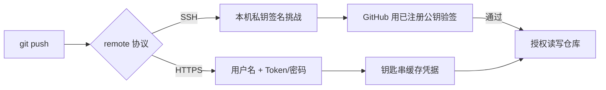
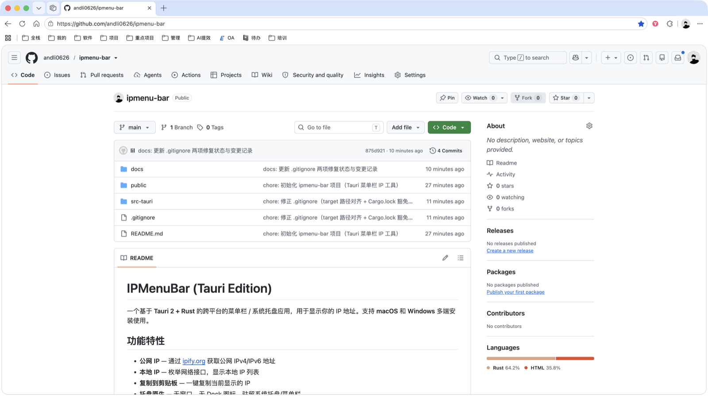
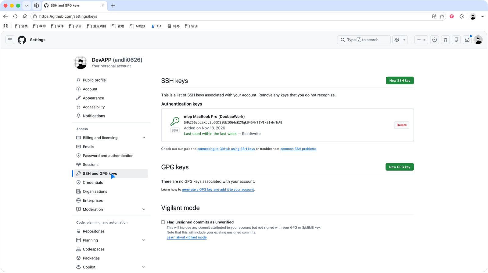
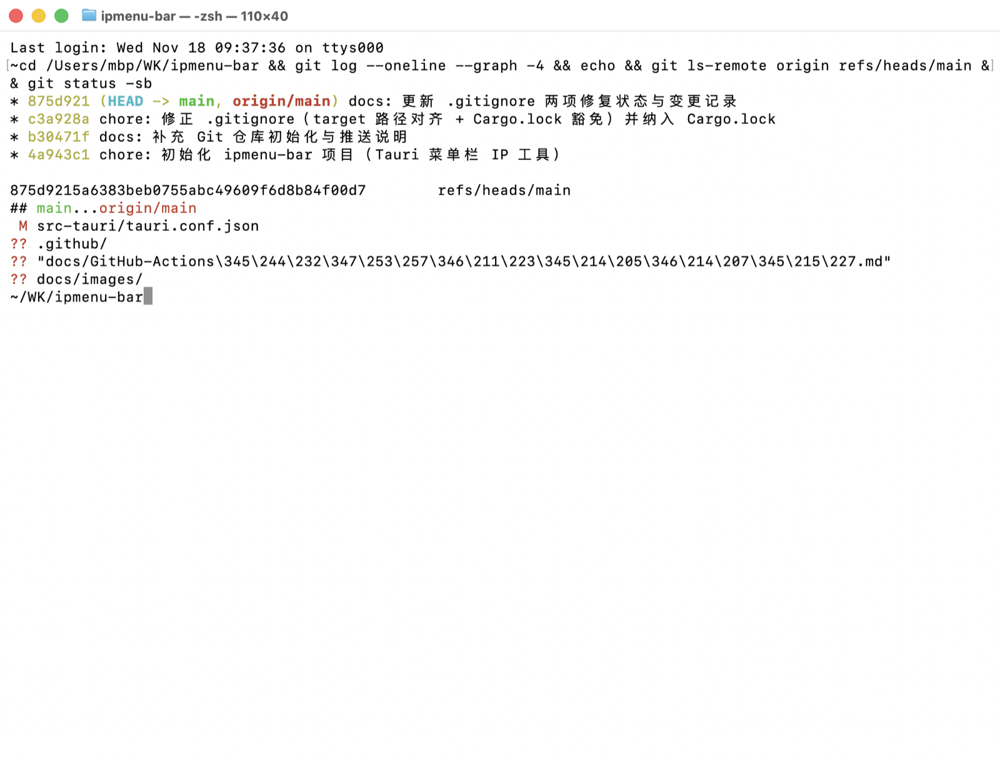

# Git 仓库初始化与推送说明

> 记录本次将本地 `ipmenu-bar` 项目提交并推送到 `https://github.com/andli0626/ipmenu-bar.git` 的完整改动与解决方案。
> 执行时间：2026-11-18　｜　提交：`4a943c1`（首推）→ `875d921`（本文档）　｜　分支：`main`
>
> 配套网页版：同目录 `Git首推操作报告.html`，浏览器直接打开即可。三张截图已以 base64 data URI **内嵌**进 HTML，单文件即可完整显示，不再依赖 `images/` 目录（`docs/images/` 仅供本文档引用）。

---

## 一、目标与结果

| 项目 | 内容 |
|---|---|
| 初始状态 | 本地目录 `/Users/mbp/WK/ipmenu-bar` 有完整代码，但**不是 Git 仓库**（无 `.git`），远程仓库为**空仓库** |
| 目标 | 本地代码入库并推送到 GitHub 空仓库 |
| 最终结果 | `main` 分支已推送成功，远程 `refs/heads/main` = 本地 `4a943c1`，32 个文件、8730 行入库 |
| 认证方式 | SSH 公钥认证（已在 GitHub 注册本机公钥） |

---

## 二、问题现象

第一次执行 `git push` 时报错：

```text
fatal: could not read Username for 'https://github.com': terminal prompts disabled
```

换用 SSH 方式测试连接时：

```text
git@github.com: Permission denied (publickey).
```

即：**HTTPS 没有可用凭据，SSH 公钥未在 GitHub 注册**，两条认证通道同时不可用。

---

## 三、根因分析

问题出在「认证」这一层，与仓库、代码、网络无关，具体三条原因叠加：

1. **本地无 Git 仓库**
   `ls -a` 显示无 `.git` 目录，说明项目此前从未被纳入版本管理，也就没有任何提交可推送。

2. **HTTPS 无凭据缓存**
   - `git config credential.helper` 为 `osxkeychain`，但钥匙串中查不到 `github.com` 条目：
     `security find-internet-password -s github.com` → *The specified item could not be found in the keychain*
   - 因此 Git 无法自动取到账号/令牌，只能退回交互式输入；而脚本执行时禁用了交互输入（`GIT_TERMINAL_PROMPT=0`），于是直接失败。

3. **SSH 公钥未注册到 GitHub**
   - 本机存在 `~/.ssh/id_rsa` / `id_rsa.pub`，但 GitHub 账号 `andli0626` 的 **SSH keys 列表为空**（页面原话：*There are no SSH keys associated with your account.*）
   - 服务端无对应公钥，握手自然返回 `Permission denied (publickey)`。

> 结论：不是权限被拒、不是网络不通，而是**缺少服务器认可的认证凭据**。

---

## 四、解决方案

### 4.1 方案选择

| 方案 | 做法 | 评估 |
|---|---|---|
| A. HTTPS + PAT（个人访问令牌） | 在网页生成 Token，缓存到钥匙串 | 需要生成并保管令牌，令牌会出现在页面/日志中，存在泄露面 |
| **B. SSH 公钥认证（采用）** | 把本机公钥注册到 GitHub，remote 改为 SSH | 无明文密钥、一次配置长期有效、`git pull/push` 全程免输 |

选择 B：不产生可泄露的明文凭据，且与本机已有的 `~/.ssh` 密钥体系一致。

### 4.2 认证原理



SSH 方式下，**私钥始终留在本机**，只有公钥上行到 GitHub；GitHub 用公钥验证私钥签名，从而确认身份。

---

## 五、实际操作过程

### 步骤 1：初始化本地仓库并提交

```bash
cd /Users/mbp/WK/ipmenu-bar
git init -b main
git add -A
git commit -m "chore: 初始化 ipmenu-bar 项目（Tauri 菜单栏 IP 工具）"
git remote add origin https://github.com/andli0626/ipmenu-bar.git
```

提交前已确认 `.gitignore` 生效（`.DS_Store` 等未被纳入）。

### 步骤 2：在浏览器中注册本机公钥

在已登录 GitHub 的 Edge 中：

1. 头像菜单 → **Settings** → 左侧 **SSH and GPG keys**
2. 点击 **New SSH key**
3. Title 填 `mbp MacBook Pro (DoubaoWork)`
4. Key type 保持 `Authentication Key`，Key 粘贴 `~/.ssh/id_rsa.pub` 全文（含 `ssh-rsa` 前缀与末尾主机标识）
5. 提交后页面提示：*You have successfully added the key 'mbp MacBook Pro (DoubaoWork)'.*

注册结果：

| 字段 | 值 |
|---|---|
| Title | `mbp MacBook Pro (DoubaoWork)` |
| 类型 | SSH（`ssh-rsa`） |
| 指纹 | `SHA256:oLaXov3L6ODSjUbIO64sKZMqkB45N/tIWI/S1+NnNA8` |
| 添加时间 | 2026-11-18 09:15 (GMT+8) |
| 权限 | Read/write |

### 步骤 3：切换 remote 为 SSH

```bash
git remote set-url origin git@github.com:andli0626/ipmenu-bar.git
```

### 步骤 4：验证 SSH 认证

```bash
ssh -T git@github.com
# Hi andli0626! You've successfully authenticated, but GitHub does not provide shell access.
```

### 步骤 5：推送

```bash
git push -u origin main
# To github.com:andli0626/ipmenu-bar.git
#  * [new branch]      main -> main
# branch 'main' set up to track 'origin/main'.
```

### 步骤 5.1 关键画面（实拍）

以下三张截图取自当时的浏览器与终端，对应三个节点：仓库已落地、身份已登记、本地与远程同哈希。原图保存在 `docs/images/`。

**① 仓库首页：`main` 分支、4 个提交、文件树就位**



**② SSH keys 列表：密钥已登记，权限 Read/write**



**③ 终端校验：`git log` / `git ls-remote` / `git status` 三条只读命令**



> 图片说明：截图均为操作完成后的真实画面，未作修饰；第 ③ 张在新建的终端窗口中执行只读命令生成，未改动仓库状态。

---

## 六、改动清单

### 6.1 本地仓库变更

| 位置 | 变更 |
|---|---|
| `/Users/mbp/WK/ipmenu-bar/.git` | 新建（`git init -b main`） |
| `origin` | `git@github.com:andli0626/ipmenu-bar.git`（由 HTTPS 切换为 SSH） |
| `main` 跟踪 | `origin/main`（`-u` 设置上游） |
| 提交 `4a943c1` | 32 files changed, 8730 insertions(+) |

> 说明：除新建 `.git` 目录外，**未修改任何源代码、配置或用户文件**。

### 6.2 GitHub 侧变更

| 位置 | 变更 |
|---|---|
| 账号 `andli0626` 的 SSH keys | 由「空」变为 1 条：`mbp MacBook Pro (DoubaoWork)` |
| 仓库 `andli0626/ipmenu-bar` | 由「空仓库」变为含 `main` 分支、32 个文件 |

### 6.3 入库文件分类（32 个）

| 分类 | 文件 | 数量 |
|---|---|---|
| Rust 源码 | `src-tauri/src/main.rs`、`lib.rs`、`ip.rs`、`tray.rs`、`build.rs` | 5 |
| Tauri 配置 | `src-tauri/Cargo.toml`、`tauri.conf.json`、`capabilities/default.json` | 3 |
| 生成 Schema | `src-tauri/gen/schemas/*.json`（acl-manifests、capabilities、desktop/macOS/windows） | 5 |
| 应用图标 | `src-tauri/icons/`（16~1024 各尺寸 PNG、`@2x`、`icon.ico`、`tray-icon.png`） | 14 |
| 前端 | `public/index.html` | 1 |
| 文档 | `README.md`、`docs/界面截图1.png`、`docs/界面截图2.png` | 3 |
| 版本控制配置 | `.gitignore` | 1 |

### 6.4 未入库内容（按忽略规则排除）

| 内容 | 排除来源 |
|---|---|
| `.DS_Store`（根目录与 `src-tauri/` 下各一份） | 项目 `.gitignore` 明确规则 |
| `src-tauri/Cargo.lock` | 项目 `.gitignore:28` 的 `*.lock`（经 `git check-ignore -v` 确认） |
| `src-tauri/target/`（当前不存在） | 本机全局 `~/.gitignore_global` 的 `target` 规则，**非**项目规则（见 7.1） |

---

## 七、遗留问题与建议

### 7.1 【已修复】`.gitignore` 的 target 路径与实际目录不匹配

> 状态：已在提交 `c3a928a` 修复并推送。

项目 `.gitignore` 原写作：

```gitignore
desktop/src-tauri/target/
```

而项目实际结构是仓库根目录下直接为 `src-tauri/`（没有 `desktop/` 中间层）。因此这条规则**匹配不到** `src-tauri/target/`。

当时未暴露问题的原因（验证结果）：

```text
$ git check-ignore -v src-tauri/target/debug/foo
/Users/mbp/.gitignore_global:80:target	src-tauri/target/debug/foo
```

即：真正生效的是本机**全局** gitignore `~/.gitignore_global` 里的 `target` 规则，**不是**项目内规则。

**风险**：项目安全依赖了「个人全局配置」这一本机环境——换机器、CI 环境或他人克隆后不会继承该配置；届时执行 `cargo tauri build` 生成数 GB 的 `src-tauri/target/`，`git add -A` 会把整个构建产物入库，造成仓库暴涨、推送失败。

**已采用的修复**（写入项目 `.gitignore`，让规则自洽，不再依赖个人环境）：

```gitignore
# Rust / Tauri build artifacts
target/
src-tauri/target/
```

修复后验证：

```text
$ git check-ignore -v src-tauri/target/debug/foo
.gitignore:36:src-tauri/target/	src-tauri/target/debug/foo
```

项目规则命中，脱离对 `~/.gitignore_global` 的依赖。

### 7.2 【已修复】`*.lock` 误伤 `Cargo.lock`

> 状态：已在提交 `c3a928a` 修复，并将 `src-tauri/Cargo.lock` 纳入版本控制。

`.gitignore` 中 macOS 段落的 `*.lock` 会连带忽略 `src-tauri/Cargo.lock`。对**应用类**（非 library）Rust 项目，`Cargo.lock` 应当入库，以保证不同机器构建时依赖版本一致、可复现。

**已采用的修复**：

```gitignore
*.lock
# Cargo.lock 是应用类 Rust 项目应入库的依赖锁文件，此处豁免
!Cargo.lock
```

修复后验证（无输出即表示不再被忽略）：

```text
$ git check-ignore -v src-tauri/Cargo.lock
（未命中忽略规则）

$ git status -sb
?? src-tauri/Cargo.lock        # 变为待跟踪文件
```


### 7.3 【文档一致性】README 目录结构与实际不一致

`README.md` 的「项目结构」与运行命令均以 `desktop/` 为根（如 `cd desktop`、`desktop/src-tauri/...`），但仓库实际是**项目根目录即 `src-tauri/`**。建议同步修正 README，避免新同学按旧路径执行失败。

### 7.4 【认证冗余】HTTPS 通道仍未配置凭据

本次只打通了 SSH。若后续在**没有 SSH 私钥**的环境（如 CI、容器、他人机器）需要推送，仍需配置 PAT 或部署密钥。当前机器日常使用 SSH 即可，无需额外处理。

### 7.5 【安全提醒】

- 私钥 `~/.ssh/id_rsa` 仍为无口令或弱保护状态时应考虑改用 `ssh-ed25519` 并加 passphrase
- GitHub 侧该密钥权限为 **Read/write**，若不再使用请及时在 SSH keys 页面删除

---

## 八、换机 / 新环境复现步骤

```bash
# 1. 确认认证可用
ssh -T git@github.com          # 应返回 Hi <username>!

# 2. 克隆（SSH）
git clone git@github.com:andli0626/ipmenu-bar.git

# 3. 日常提交推送
git add -A
git commit -m "feat: xxx"
git push
```

若新机器尚无密钥：

```bash
ssh-keygen -t ed25519 -C "your_email@example.com"   # 一路回车
cat ~/.ssh/id_ed25519.pub                            # 粘贴到 GitHub → SSH keys → New SSH key
```

---

## 九、命令速查（本次执行过）

| 目的 | 命令 |
|---|---|
| 查看仓库状态 | `git status -sb` |
| 查看远程 | `git remote -v` |
| 初始化并指定分支 | `git init -b main` |
| 暂存全部（尊重 .gitignore） | `git add -A` |
| 首次提交 | `git commit -m "chore: 初始化 ipmenu-bar 项目（Tauri 菜单栏 IP 工具）"` |
| 添加远程 | `git remote add origin <url>` |
| 改远程为 SSH | `git remote set-url origin git@github.com:andli0626/ipmenu-bar.git` |
| 测试 SSH 认证 | `ssh -o BatchMode=yes -T git@github.com` |
| 首推并设上游 | `git push -u origin main` |
| 校验远程引用 | `git ls-remote origin` |

---

## 十、验证证据

```text
$ ssh -T git@github.com
Hi andli0626! You've successfully authenticated, but GitHub does not provide shell access.

$ git push -u origin main
To github.com:andli0626/ipmenu-bar.git
 * [new branch]      main -> main
branch 'main' set up to track 'origin/main'.

$ git ls-remote origin
4a943c1eb2c5637b89a2b64cf18cb3e99c2e92a0	HEAD
4a943c1eb2c5637b89a2b64cf18cb3e99c2e92a0	refs/heads/main

$ git status -sb
## main...origin/main
```

远程 `HEAD`、`refs/heads/main` 与本地提交哈希三方一致，说明推送内容完整、无分叉。

---

## 十一、后续变更记录

| 提交 | 内容 | 说明 |
|---|---|---|
| `4a943c1` | `chore: 初始化 ipmenu-bar 项目（Tauri 菜单栏 IP 工具）` | 首推：32 个文件、8730 行 |
| `b30471f` | `docs: 补充 Git 仓库初始化与推送说明` | 新增本文档 |
| `c3a928a` | `chore: 修正 .gitignore（target 路径对齐 + Cargo.lock 豁免）并纳入 Cargo.lock` | 落实 7.1 / 7.2；入库 `Cargo.lock`（5221 行），仓库文件数由 32 → 34 |
| `875d921` | `docs: 更新 .gitignore 两项修复状态与变更记录` | 7.1 / 7.2 标记为已修复，新增本节 |
| `04ff8e2` | `docs: 补充操作截图并新增网页版操作报告` | 新增 `docs/images/` 三张实拍截图与 `Git首推操作报告.html` |

> 注：第六节的「32 个文件」指首推提交 `4a943c1` 的范围，为历史记录，不再随后续提交变动。

---

*本文档由本次推送任务生成，可作为仓库首次接入 GitHub 的操作留档。*
