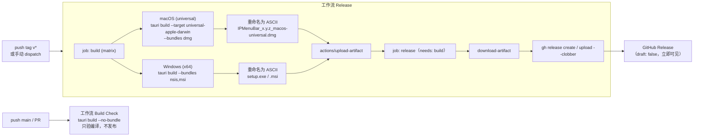

# IPMenuBar 多端自动打包实现过程说明

> 记录范围：从评估现有工程到 GitHub Actions 上跑通 macOS / Windows 双端自动打包、自动发布，并落地上线一条 `v1.2.4` 正式发布的全过程。
> 配套文档：`docs/GitHub-Actions多端打包指南.md`（面向日后运维的操作手册，本文是"为什么这么做、当时踩了什么"的过程复盘）。

---

## 一、目标与约束

| 项 | 内容 |
|---|---|
| 目标 | 一次打 tag，自动产出 macOS（Apple Silicon + Intel）与 Windows（安装版 + MSI）三件套，并自动发布到 GitHub Releases |
| 成本约束 | **零成本**：不买 Apple Developer 证书（$99/年），不买 Windows 代码签名证书（$200+/年），不引入任何付费 CI |
| 平台约束 | 公开仓库（Actions 分钟数不计费）；私有签名密钥一律不入库 |
| 工程约束 | 保持现有技术栈（Tauri 2 + Rust + 纯静态前端），不为了 CI 引入 Node 构建链 |

---

## 二、起点：工程现状评估

| 维度 | 评估结果 | 对 CI 的影响 |
|---|---|---|
| 技术栈 | Tauri 2.11 + Rust 2021，单 crate 位于 `src-tauri/` | 只有一个编译单元，CI 逻辑简单 |
| 前端 | 纯静态 `public/index.html`，`beforeBuildCommand` 为空，`frontendDist: ../public` | **不需要 Node 构建链**，CI 上省掉一整套 npm 步骤 |
| 依赖锁定 | `Cargo.lock` 已入库 | 构建可复现，缓存命中率高 |
| 打包目标 | `bundle.targets: "all"` | 需按平台显式限定 bundle 类型，否则会尝试打用不上的包 |
| 图标 | 有 `icon.ico` 与多尺寸 PNG，缺 512/1024 层 | macOS 上 dmg 图标分辨率不足 |
| 版本 | `Cargo.toml` 与 `tauri.conf.json` 双源 | 容易打出一个"包名和版本对不上"的产物 |
| 仓库 | `andli0626/ipmenu-bar`，公开库，默认分支 `main` | Actions 免费，无需额外预算 |

**结论**：这是一个非常适合上 GitHub Actions 的工程——没有前端构建、没有多模块、依赖锁定，CI 只需承担"Rust 编译 + Tauri 打包"这一件事，成本几乎只有编译时间。

---

## 三、评估中发现的问题与处置

| 编号 | 问题 | 用户侧影响 | 处置 | 状态 |
|---|---|---|---|---|
| P0-1 | macOS 包未签名 | Apple Silicon 用户下载后报"应用已损坏，无法打开" | 配置 `bundle.macOS.signingIdentity: "-"`，走 **ad-hoc 签名**；无需证书、无需密钥 | 已实现 |
| P0-2 | Windows 托盘不支持显示文字 | `TrayIcon::set_title` 在 Windows 上是 Unsupported，用户装完看不到 IP | 新增 Windows 常驻浮窗（`pill.rs` + `pill.html`），实现"菜单栏常显 IP"的等价体验 | 已实现 |
| P1-1 | 图标清单缺 512/1024 层 | macOS 高分屏下 dmg/应用图标模糊 | 新增 `256x256.png`、`512x512.png`、`512x512@2x.png`（注意 Tauri 按**文件名**匹配类型，1024px 图必须命名为 `512x512@2x.png`） | 已修复 |
| P1-2 | 版本双源 | 产物版本号可能与 tag 不一致 | CI 增加 `tag / Cargo.toml / tauri.conf.json` 三向校验，不一致直接失败 | 已实现 |
| P1-3 | `productName` 为中文「ip地址」 | 产物文件名被 percent-encode 或含中文，下载链接难看且易出错 | 构建后统一重命名为 ASCII：`IPMenuBar_<ver>_<platform>.<ext>` | 已实现 |
| P1-4 | WiX MSI 默认代码页 1252 | 中文 productName 触发 `LGHT0311`，MSI 打包失败（NSIS 不受影响） | `bundle.windows.wix.language: "zh-CN"` | 已修复 |
| P2-1 | 发布策略 | 首版用 `tauri-action` 单 job 构建+发布，任一平台失败会留下"只有一半资产"的已发布 Release | 拆成 `build`(矩阵并行) → `release`(汇总发布) 两段 | 已重构 |

---

## 四、方案设计

### 4.1 工作流拓扑



### 4.2 关键设计决策

| 决策 | 选择 | 理由 |
|---|---|---|
| 工作流数量 | 2 条：`release.yml`（tag 触发）+ `build-check.yml`（push/PR 触发） | 日常提交只验编译（约 6 分钟、不产包），发版才跑完整打包，省时间也省资源 |
| 是否用 `tauri-action` | **不用**，改用 shell 直接跑 `tauri build \| tee build.log` | `tauri-action` 会把构建与发布耦合在同一个 job 里；CLI 原始报错也更容易进日志。拆开后失败原因可读、可重跑 |
| 构建与发布 | 两段式，artifact 中转 | 任一平台失败都不会创建 Release；发布 job 可单独重跑，幂等（`--clobber`） |
| 产物命名 | 构建时改名为 ASCII | 规避中文/空格导致的下载链接编码问题，同时不动产品显示名 |
| macOS 签名 | `signingIdentity: "-"`（ad-hoc） | 零成本让 Apple Silicon 能正常打开；未来买证书只需把注释掉的 `APPLE_SIGNING_IDENTITY` 恢复即可平滑升级 |
| Windows 签名 | 不做 | 代码签名证书年费高；代价是首次运行 SmartScreen 提示，已在 Release 说明中告知用户 |
| 缓存 | `Swatinem/rust-cache@v2`，`workspaces: src-tauri -> target` | target 目录 2~3 GB，冷/热构建差 4 倍以上 |

---

## 五、实施过程（按轮次复盘）

| 轮次 | 做了什么 | 结果 / 现象 | 结论与下一步 |
|---|---|---|---|
| 1 | 新增两条 workflow、Windows 浮窗、图标补全；推 `main` | `Build Check` 两个平台全绿（run `44220418192`） | Windows 分支代码编译通过，可以尝试发版 |
| 2 | 打 tag `v1.2.4`（run `44221060819`） | macOS 成功；Windows 构建失败 | **副作用暴露**：macOS 先完成就已创建 Release，留下一个只有 dmg 的"半成品发布页" → 必须拆 build/release |
| 3 | 重构为 `build → release`，构建改用 shell + `tee build.log`，失败日志写入 job summary；重打 tag（run `44222759090`） | Windows 仍在 `Build bundles` 失败 | 日志接口匿名不可读，改为本地复现 |
| 4 | 在 Windows 机器上克隆该 tag 本地复现 | 复现出 `error LGHT0311 : ... code page '1252'`；同轮 NSIS 成功 | 根因确认：WiX MSI 装不下中文 productName |
| 5 | 本地试 `wix.language: zh-CN` | MSI 打包成功（`ip地址_1.2.4_x64_zh-CN.msi`） | 修复有效，回写仓库 |
| 6 | 提交修复并重打 tag（run `44229295091`） | 三个 job 全绿，Release 三件套齐备 | 发版链路打通 |
| 7 | 在 Windows 真机跑构建产物，验证浮窗 | 发现窗口存在、内容已渲染，但屏幕上看不到 | 根因：WebView2 透明分层窗口在 Windows 上不可见 |
| 8 | 改为不透明窗口 + 页面自铺底色，真机复测（run `44231295409`） | 浮窗正常显示，位于工作区右下角、自动避开任务栏 | 定稿 |

### 5.1 三个值得记住的坑

1. **`tauri-action` 单 job 的"半成品 Release"**
   矩阵里 macOS 先完成就建了 Release 并 publish，Windows 后失败——用户看到的是一个缺 Windows 资产的发布页。解法是把"发布"挪到最后一个 job，且必须 `needs: build` 全绿才执行。

2. **WiX 1252 代码页 vs 中文 productName**
   `main.wxs` 里只要出现「ip地址」，`light.exe` 就报 `LGHT0311`。NSIS 用 Unicode 不受影响，所以现象是"同一个 productName，exe 出得来、msi 出不来"。修复只需一个字段：`"wix": { "language": "zh-CN" }`（注意产物名会多出 `_zh-CN` 后缀，正好被统一改名规则吃掉）。

3. **Windows 透明的坑不在 CSS，在窗口合成**
   `transparent(true)` 后，`PrintWindow` 能抓到完整画面（绿点 + IP 都在），但屏幕合成结果为空——不是样式问题，也不是内容没加载。判定手段：窗口矩形正确 + `IsWindowVisible=1` + `PrintWindow` 有内容，而屏幕截图空白，即可锁定为透明合成问题。解法：改为不透明窗口，让 HTML 自己铺满深色底，代价是四角变直角。

   另有一个**排查陷阱**：Windows 笔记本是 2560×1440 @150%，而 PowerShell 默认非 DPI 感知，`CopyFromScreen` 截到的是 1707×960 的逻辑缓冲，浮窗按物理像素定位（2167,1338）正好落在缓冲之外，看起来"没显示"。必须先 `SetProcessDpiAwareness(2)` 再截图，否则会误判。

---

## 六、关键实现

### 6.1 `release.yml` 结构

| 阶段 | 内容 |
|---|---|
| 触发 | `push: tags: ['v*']`、`workflow_dispatch` |
| 权限 | `permissions: contents: write`（发布需要写权限） |
| 并发 | `concurrency` 按 ref 分组，重复触发不互相覆盖 |
| 版本校验 | 从 tag 剥 `v`，与 `Cargo.toml`、`tauri.conf.json` 比对，不一致即失败 |
| 构建 | `tauri build` + `tee build.log`；失败时把日志尾部写入 `$GITHUB_STEP_SUMMARY` |
| 改名 | 产物统一重命名为 `IPMenuBar_<ver>_<platform>.<ext>` |
| 归档 | `actions/upload-artifact`（每个平台一个 artifact） |
| 发布 | `download-artifact` 汇总 → `gh release create --notes-file .github/release-notes.md` → `gh release upload --clobber` |

### 6.2 `tauri.conf.json` 关键字段

| 字段 | 取值 | 作用 |
|---|---|---|
| `bundle.macOS.signingIdentity` | `"-"` | ad-hoc 签名，零证书可运行 |
| `bundle.windows.wix.language` | `"zh-CN"` | 让 MSI 用 936 代码页，容纳中文产品名 |
| `bundle.icon` | 含 `32/128/128@2x/256/512/512@2x/icon.ico` | 覆盖 macOS 高分屏与 Windows ico |
| `bundle.targets` | `"all"`（CI 里用 `--bundles` 显式收窄） | 保持本地默认行为 |

### 6.3 Windows 浮窗

| 要点 | 实现 |
|---|---|
| 尺寸/形态 | 248×54 逻辑像素，无边框、置顶、`skip_taskbar`、不抢焦点 |
| 定位 | `Monitor::work_area()` 右下角内缩 14px —— 用工作区而非屏幕尺寸，自动避开任务栏 |
| 数据流 | 后端在"公网 IP 刷新 / 切换网卡 / 主 IP 变化"时 `emit("ip:update")`；前端首屏再 `invoke("get_current_ip")` 兜底，避免 emit 早于监听注册 |
| 交互 | `data-tauri-drag-region` 拖动、复制按钮、收起按钮；收起后点托盘图标唤回（不销毁 webview） |
| 平台判定 | 运行时 `cfg!(target_os = "windows")` 而非 `#[cfg]`，保证这段代码在 macOS 上也参与编译校验 |
| 透明度 | **不使用透明窗口**（见 5.1 坑 3） |
| 权限 | `capabilities/default.json` 的 `windows` 白名单加入 `"pill"`，并放行 `core:window:allow-hide`、`core:window:allow-start-dragging` |

---

## 七、验证矩阵

| 验证项 | 手段 | 结果 |
|---|---|---|
| macOS dmg 可安装、签名有效 | 本地 `CI=true tauri build --bundles dmg`，`hdiutil attach` + `codesign -dvv` | `Signature=adhoc`、`flags=0x10002(adhoc,runtime)`，`codesign --verify --strict` 通过 |
| macOS 本地打包不卡 Finder 美化 | 对比带/不带 `CI=true` | 不带时 `bundle_dmg.sh` 的 AppleScript 步骤失败；带 `CI=true` 跳过，CI 环境天然满足 |
| Windows 编译 | `Build Check`（`--no-bundle`） | 两平台全绿 |
| Windows MSI 打包 | 本地复现 → 改 `wix.language` → 重跑 | 修复前 `LGHT0311` 失败，修复后产出 3.84 MiB MSI |
| Windows 浮窗真机表现 | 真机运行 exe + DPI 感知截图 | 浮窗显示正常，IP 正确，位置避开任务栏 |
| 发版全链路 | 三次 tag 运行 | 最终 run `44231295409` 三个 job 全部 success，Release 三件套齐备 |

---

## 八、发布结果

| 项 | 内容 |
|---|---|
| 发布页 | <https://github.com/andli0626/ipmenu-bar/releases/tag/v1.2.4> |
| Release 名称 | `IPMenuBar v1.2.4`（`draft: false`，打 tag 即发布） |
| 资产 | `IPMenuBar_1.2.4_macos-universal.dmg` / `IPMenuBar_1.2.4_windows-x64-setup.exe` / `IPMenuBar_1.2.4_windows-x64.msi` |
| 构建流水线 | run `44231295409`（`macOS (universal)` / `Windows (x64)` / `Publish release` 全部 success） |

---

## 九、运维手册

### 9.1 发版三步

```bash
# 1. 同步版本号（Cargo.toml 与 tauri.conf.json 必须一致）
# 2. 提交并推主干
git commit -am "chore: release vX.Y.Z" && git push origin main
# 3. 打 tag 触发自动打包与发布
git tag vX.Y.Z && git push origin vX.Y.Z
```

只想验证编译、不发布：推 `main` 即可（`Build Check`）。

### 9.2 故障排查表

| 症状 | 根因 | 处理 |
|---|---|---|
| Release 只有部分资产 | 构建与发布耦合在同一个 job | 确认用的是 `build → release` 结构，`release` 必须 `needs: build` |
| Windows job 报 `LGHT0311` | WiX 代码页装不下中文 | 确认 `wix.language` 为 `zh-CN` |
| 产物名带中文/百分号编码 | `productName` 是中文 | 靠构建后的统一改名步骤，不要改产品显示名 |
| 版本校验失败 | tag 与 Cargo.toml / tauri.conf.json 不一致 | 三处同步后重新打 tag |
| 本地 mac 打包卡住 | `bundle_dmg.sh` 的 AppleScript 美化步骤 | 加 `CI=true` 前缀 |
| 浮窗在 Windows 上"看不见" | 透明分层窗口合成失败 / 截图未 DPI 感知 | 用不透明窗口；排查时先 `SetProcessDpiAwareness(2)` |

### 9.3 后续可选升级

| 升级项 | 触发条件 | 需要做什么 |
|---|---|---|
| 正式 Apple 签名 + 公证 | 开始对外分发、不想让用户右键绕过 Gatekeeper | 买证书，配 `APPLE_CERTIFICATE` / `APPLE_ID` / `APPLE_TEAM_ID` 等 Secrets，恢复 `APPLE_SIGNING_IDENTITY` |
| Windows 代码签名 | 用户量上来、SmartScreen 提示影响转化 | 买证书（或用 Azure Trusted Signing），配 `certificateThumbprint` / `timestampUrl` |
| 自动更新（updater） | 需要"应用内升级" | 引入 `tauri-plugin-updater` + `latest.json`，签名密钥需另配 |
| 版本单源 | 版本双源反复出错 | 用脚本从 `tauri.conf.json` 生成 `Cargo.toml` 版本，或引入 `cargo-release` |

---

## 十、成本核算

| 项 | 消耗 | 费用 |
|---|---|---|
| GitHub Actions | 公开仓库不计分钟数；单次发版约 12 分钟（mac 8 min + win 10 min 并行，release 1 min） | 0 |
| 缓存存储 | rust-cache 约 1~2 GB（受仓库配额回收策略约束） | 0 |
| 签名 | macOS ad-hoc（无证书）、Windows 不签名 | 0 |
| 分发 | GitHub Releases 静态托管 | 0 |
| **合计** | | **0 元 / 年** |

> 唯一"成本"是首次运行的用户体验：macOS 需右键打开（ad-hoc 签名），Windows 首次运行有 SmartScreen 提示——已在 Release 说明中写明。
